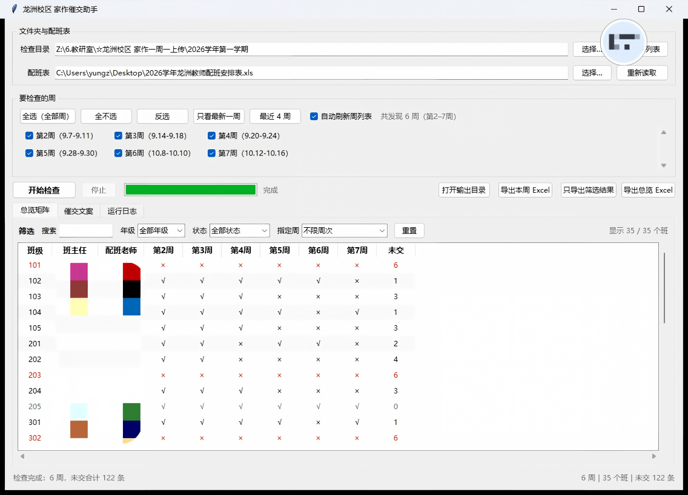
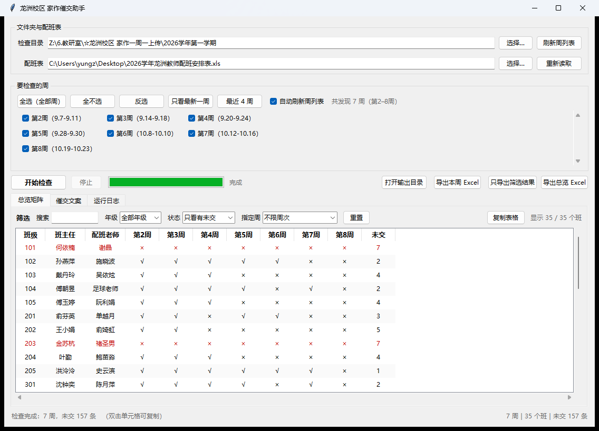

# 龙洲校区「家作一周一上传」催交助手

**最省事：双击桌面 `家作催交助手` 文件夹里的 `家作催交助手.exe`**（免安装，22 MB 单文件，不需要装 Python）。

也可以直接跑源码：**双击 `打开界面.bat`**，选目录 → 自动列出所有周 → 勾周次 → 点检查 → 按上交状态筛选 → 复制催交文案。

命令行版仍然保留，双击 `运行.bat` 即可。



---

## exe 放哪里

建议单独放一个文件夹，比如桌面上的 `家作催交助手\`，因为程序会在 exe 同目录生成：

- `配班表.csv`（自动缓存的班主任表）
- `输出\`（导出的 Excel）

如果直接扔在桌面根目录，桌面上就会多出这两个东西。

> 放 D 盘、U 盘都可以，程序是绿色版，不写注册表。极少数情况下双击报
> `Could not create temporary directory`，把 exe 挪到普通目录（桌面 / D 盘）再运行即可——
> 说明它被放在了一个写入受限的目录里。

---

## 文件说明

| 文件 | 作用 |
|---|---|
| `打开界面.bat` | **双击启动图形界面**（推荐） |
| `运行.bat` | 命令行版，默认检查最新一周；可带参数 |
| `查看所有周.bat` | 列出各周目录和文件数 |
| `gui.py` | 图形界面 |
| `cli.py` | 命令行版 |
| `checker.py` | 共用核心：读配班表、扫描判定、生成文案、导出表格 |
| `配班表.csv` | 从 `.xls` 自动缓存的「班级—班主任」表，自动生成/更新，不用手改 |
| `输出\` | 每次导出的 Excel 都放这里 |
| `截图\` | 界面截图 |
| `app.ico` | 打包 exe 时用的程序图标 |

> 说明：入口脚本用英文名（`gui.py` / `cli.py`），是因为 .bat 里写中文文件名容易因编码问题打不开；界面和按钮全是中文，不影响使用。

---

## 图形界面怎么用

1. 双击 `打开界面.bat`。
2. **检查目录**：默认已填好学年目录。要换就点「选择…」，可以选学年目录（里面有 `第N周…` 文件夹），也可以**直接选某一周**（程序认得出目录名里的“第N周”）。
3. **配班表**：默认指向桌面的 `2026学年龙洲教师配班安排表.xls`。换了表就点「选择…」，支持 `.xls` 和 `.xlsx`。
4. **勾选周次**（周列表是**自动读取目录**生成的，有几周就显示几周）：
   - 点「全选（全部周）」= 检查全部周；
   - 点「只看最新一周」/「最近 4 周」= 快速缩小范围；
   - 手动勾几周就是查几周。
   - **自动刷新周列表**默认开启：每 30 秒探一次目录，以后新加了「第8周…」文件夹会自动出现在列表里，状态栏和日志会提示“新增 第8周”。
     - 之前是**全选** → 新周自动跟着勾上；
     - 之前只勾了某几周 → 新周**不自动勾**（避免悄悄多扫一周），但会明确提示。
5. 点 **开始检查**。网络盘首次扫描可能要几秒，进度条会显示正在扫哪一周。
6. 结果分三个页签：

   - **总览矩阵**：每个班一行，每周一列，`√` 已交 / `×` 未交。**六周全缺的班会整行标红**，全交的标绿——一眼看出谁一直在漏交。
   - **催交文案**：选周次、选「群发一条」或「逐个发送」，点「复制文案」直接粘到钉钉。
   - **运行日志**：读取配班表、扫描过程、报错都记在这里。

### 总览矩阵的筛选

矩阵上方有一排筛选，右下角显示「显示 x / 35 个班」：

| 筛选 | 用法 |
|---|---|
| **搜索** | 输班号或姓名，边打边筛，如 `何`、`501`、`张` |
| **年级** | 全部 / 一年级 … 六年级 |
| **状态** | `只看有未交`（默认最常用）/ `只看全交` / `只看全缺` |
| **指定周** | 只留**某一周没交**的班，比如选「第7周」就只剩第 7 周缺交的 |
| **重置** | 一键清空所有筛选 |

几个筛选可以叠加，比如「五年级 + 只看全缺 + 第7周缺交」。



### 表格内容都能复制

表格里的文字（班级、班主任、配班老师、各周 √×、未交次数）都能直接复制出来，四种方式：

| 操作 | 复制什么 |
|---|---|
| **双击某个单元格** | 只复制这一格，比如双击「何依楠」就只复制姓名 |
| **点一行后 Ctrl+C** | 复制整行，制表符分隔（粘到 Excel 会自动分列） |
| **右键菜单** | 复制这一行 / 只复制班主任姓名 / 复制「班级 班主任」清单 / 复制整张表 |
| **「复制表格」按钮** | 复制**当前筛选出来的**整张表（含表头），粘到 Excel 直接成型 |

几个实用场景：

- 只要一串能发群的名单 → 右键「复制「班级 班主任」清单」，得到
  `101 何依楠、102 孙燕萍、103 戴丹玲…`
- 想自己排个表 → 「复制表格」，粘到 Excel 自动分列，筛选过就只复制筛出来的
- 只要某个班主任名字 → 双击那一格

7. 导出：
   - **只导出筛选结果**：只把当前筛出来的班级导成表（比如“五年级 + 只看全缺”就是 4 个班），方便单独发给年级组长。
   - **导出总览 Excel**：完整 35 个班，一张矩阵表 + 一张未交明细（周次/年级/班级/班主任）。
   - **导出本周 Excel**：当前选中那一周的未交清单、已交清单、未识别文件。
   - **打开输出目录**：直接打开 `输出\`。

   > 筛选只影响**看**：点「导出总览 Excel」永远导全部 35 个班；要只导筛选结果就点「只导出筛选结果」。

   矩阵的列头只显示「第7周」这种短标题（日期范围在勾选框和「指定周」下拉里看），这样 6 周也能一屏放下，不用左右拖。


---

## 命令行怎么用

```bat
运行.bat                     :: 最新一周
运行.bat --week 7            :: 指定第 7 周
运行.bat --all               :: 全部周 + 导出总览矩阵
运行.bat --list              :: 列出各周文件数
运行.bat --dir "D:\某周目录"  :: 直接指定目录
```

---

## 班号是怎么识别出来的

扫到每个文件后，按优先级推断它属于哪个班：

1. **子文件夹名**正好是班号 —— `第7周\5年级\501\1.jpg` → 501
2. **文件名开头三位** —— `301.JPG`、`204班1--2.jpg`、`402-1.jpg`、`105-2.JPG`
3. **文件名里任意三位数**，且该班号确实在配班表里 —— `作业405.jpg` → 405

`20261019.jpg` 这种日期命名的文件**不会**被误判成 202 班（三位数后面还跟着数字就排除）。

自动忽略 `Thumbs.db`、`desktop.ini`、`*.db`、`~$*`。

> 判定口径：**一个班只要有一个文件就算已交**，多张图记张数。识别不出班号的文件单独列进「未识别文件」页，不静默丢掉。

---

## 判定为什么要拿配班表当全集

原来那个 `读取文件列表.bat` 用的是 `Get-ChildItem -Recurse -File`，**只列文件不列文件夹**。某个班一个文件都没交，它在 txt 里根本不出现——所以从那份列表反推，永远算不出"缺哪些班"。

本工具是拿配班表的 35 个班当全集去比对，缺的才准。而且每次现扫现算，不读任何缓存名单（实测同一周隔两小时文件数会从 1 变 11）。

配班表是**横向双栏**布局（A/B/C 和 E/F/G 两块并排），程序按表头「班级」自动定位每个块的列，以后表格挪列也不容易崩。

---

## 输出物

`输出\` 里会有：

| 文件 | 内容 |
|---|---|
| `上交总览_…xlsx` | 多周矩阵 + 未交明细（全部班级） |
| `筛选结果_…xlsx` | 只含筛选出来的班级，副标题会写明筛选条件 |
| `催交名单_第N周_….xlsx` | 单周：未交清单 / 已交清单 / 未识别文件 |
| `催交名单_第N周_….csv` | 未交清单纯文本版 |
| `钉钉_逐个发送_第N周.txt` | 每位班主任一段，逐段复制 |
| `钉钉_群发一条_第N周.txt` | 群里发一条，按年级归类 |

单条文案：

```
何依楠老师，您好！
截至10月19日 11:51，101班第7周（10.12-10.16）的家作还未上传到共享盘
"☆龙洲校区 家作一周一上传\2026学年第一学期\第7周（10.12-10.16）"。
（配班：谢晶）麻烦您抽空补交一下，谢谢！
```

---

## 换校区 / 换学期

界面里直接改「检查目录」和「配班表」两个路径即可，不用改代码。

命令行也可以临时指定：

```bat
运行.bat --year-dir "Z:\...\2027学年第一学期" --roster "D:\新配班表.xls"
```

改默认值：编辑 `checker.py` 顶部的 `DEFAULT_YEAR_DIR` 和 `DEFAULT_ROSTER_XLS`。

---

## 自己重新打包 exe

改了代码想重新出 exe：

```bat
python -m pip install pyinstaller
python -m PyInstaller --noconfirm --clean --onefile --windowed ^
  --name 家作催交助手 --icon app.ico ^
  --exclude-module numpy --exclude-module pandas --exclude-module matplotlib ^
  gui.py
```

生成的 `dist\家作催交助手.exe` 就是单文件成品。

几个打包时踩过的坑，已经写进代码里了：

1. **输出目录不能用 `__file__`**。单文件 exe 运行时 `__file__` 指向临时解压目录 `_MEIxxxx`，程序一退就没了。`checker.py` 里加了判断：打包环境下用 `sys.executable` 的目录，所以 `配班表.csv` 和 `输出\` 会乖乖待在 exe 旁边。
2. **窗口模式下 `sys.stdout` 是 `None`**，任何 `print()` 都会抛异常（表现为双击后弹错误框）。`gui.py` 启动时已把 stdout/stderr 兜到 `os.devnull`。
3. `--exclude-module numpy/pandas` 能省下十几 MB，程序本身用不到。

---

## 关于「自动发钉钉」

工具**只生成文案，不自动发**。要真自动发，两条路：

- **群机器人**：钉钉群里加自定义机器人，把 webhook（和加签密钥）给我，可以往群里发并按手机号 @ 人。**只能发群，不能私聊。**
- **企业应用**：需要学校钉钉管理员建应用，提供 appKey / appSecret 和班主任 userid，才能 1:1 推到个人。

给凭据就能接上去。
